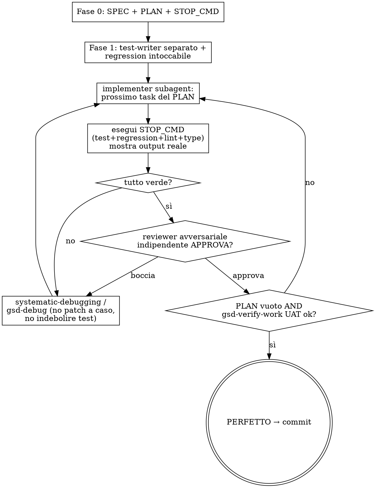

# autoloop — autonomous loop “define → implement → test → fix to perfection”

Index: When to use · Principle · Requirements · Phase 0 · Phase 1 · Phase 2 · Phase 3 · Stop criteria · Flowchart · Rules · Extensions · Self-improvement

Orchestrates existing skills (GSD, superpowers, ralph-loop, when installed) into one autonomous loop with **genuine test gates**: the loop stops only when the work is really finished, not when “the tests are green.”
It does not duplicate those skills; it coordinates them.

Checklist (if a check fails, return to the indicated step):
- [ ] Phase 0 complete: SPEC, PLAN, and measurable stop criteria (if they aren't measurable, stay at step 4)
- [ ] Phase 1 complete: tests written by the test-writer, regression suite frozen, STOP_CMD written (if any are missing, return to step 5)
- [ ] Each iteration at step 11 shows the actual output and gets reviewer approval (if red, debug and repeat step 11)
- [ ] Phase 3: validate, verify, audit, docs (if a check fails, return to step 11)
- [ ] Step 15: everything green and UAT confirms the intent

## When to use it / when NOT to

| Situation | Right skill |
|---|---|
| “Complete THIS task/feature on your own, until it's perfect” | **autoloop** (this one) |
| “Work while I sleep / research + report + overnight build” | `lavoro-notturno` (may call autoloop) |
| Medium task, one R→P→I→T cycle | `rpit-loop` |
| Basic loop driver (reruns the same prompt) | `ralph-loop` (autoloop uses it as an engine) |

## Principle

The agent must never be able to “win” by weakening tests: otherwise the loop could finish green without solving anything. The value (“when I reopen this, I have nothing to fix”) comes from the gates, not the loop. Gate details: `references/test-gates.md`.
## Requirements

For STOP_CMD examples (adapt them to the project's real commands):
- Python: `.venv/bin/pip install pytest ruff mypy` (Linux) · `.venv/Scripts/pip install pytest ruff mypy` (Windows)
- Frontend: `npm --prefix frontend install` · E2E: `npm i -D @playwright/test && npx playwright install`
- superpowers must be installed and active wherever code is written; ralph-loop is optional: if missing, the driver is the built-in `/loop`. For overnight runs, call it from `lavoro-notturno` (no questions: decide and record).
- GSD only in projects with `.planning/` (skill `indice-gsd`); without GSD, perform its named steps manually with `rpit-loop` and `testing`.

---

## PHASE 0 — Definition (long, once)

Don't skip it: loop quality is limited by the quality of the spec and stop criteria.

1. **New project** → `gsd-new-project`. **Feature in an existing project** → `gsd-spec-phase`.
2. `gsd-discuss-phase` → resolve ambiguities with adaptive questions BEFORE writing code.
3. `gsd-plan-phase` → executable plan with atomic tasks and goal-backward verification.
4. Write **measurable stop criteria** (see below). If they aren't measurable, don't proceed.

Phase 0 output: `SPEC.md` + `PLAN.md` + stop criteria. (For richer spec ideas: GitHub Spec Kit, BMAD.)

## PHASE 1 — Truth kit (anti-reward-hacking)

5. **Test-writer separate from implementer.** Derive tests from SPEC/UAT with a dedicated subagent
   (`gsd-add-tests`), **not** from the code. The implementer must NOT be able to modify them.
6. **Regression suite off-limits.** Freeze the existing suite (fail-to-pass + pass-to-pass): the agent must
   pass new tests AND avoid breaking old ones. Mark these files read-only for the loop.
7. **Define STOP_CMD** = ALL must be true:
   `new tests green` ∧ `regression intact` ∧ `lint/type clean` ∧ `reviewer approves` ∧ `gsd-verify-work UAT ok`.

## PHASE 2 — Autonomous loop (the core)

8. **Subagent-driven execution** (always execute plans this way): a fresh subagent for every task + review.
   Use `subagent-driven-development`. More than 5 subagents total requires estimating tokens and getting the user's approval first.
9. **Loop driver**: `ralph-loop` or built-in `/loop`. For overnight runs, call it from `lavoro-notturno`
   (no questions: decide and record).
10. **Multi-tier mode** (optional, for backlogs with P1/P2/… priorities): tier N+1 starts ONLY after
    `STOP_CMD(tier N)` is completely green AND the human checkpoint passes. Tier state persists
    between iterations. Red dependencies block the tier. Details: `references/gates-extended.md §1`.
11. **On every iteration**, run the cycle (see flowchart):
    - implementer subagent executes the next PLAN task;
    - run `new tests` + `regression` + `lint/type` and **show the actual output**
      (`verification-before-completion`—never claim “done” without evidence);
    - **independent adversarial critic** (fresh subagent): agent `revisione-codice` (or
      `gsd-code-review`, if GSD is installed). It must try to BREAK the work;
    - if anything is red or the reviewer rejects it → `systematic-debugging` / `gsd-debug` (persistent state across
      cycles), then **return to step 11** (implementer). Never patch randomly or weaken a test to pass.

## PHASE 3 — Final verification (before saying “done”)

12. `gsd-validate-phase` (Nyquist) + `gsd-verify-work` (UAT) + `gsd-integration-checker` (E2E).
13. `gsd-audit-uat` / `gsd-audit-milestone`: does the delivered work match the original intent?
14. **Always-document gate**: use the `docs` agent (or the project's documentation skill) to update relevant docstrings
    and `.claude/docs/`. A tier is not “done” without updated docs (§4 gates-extended).
15. Only then is the work “perfect.” Commit and push according to `git-workflow`, with `Closes #N` if there is an issue.

**If any step from 12–14 fails, return to step 11** (implementer) with the defect found, then repeat Phase 3.
Finish only when steps 12–14 all pass and STOP_CMD is completely green.

---

## Stop criteria — must be measurable

Wire STOP_CMD to real commands, not opinions. This is an example to adapt to the project's commands (FastAPI + React; on Windows use `.venv/Scripts/...` instead of `.venv/bin/...`):

```bash
# Everything must exit with code 0
.venv/bin/python -m pytest tests/ -q              # new tests + regression
.venv/bin/ruff check .                            # lint
.venv/bin/python -m mypy app/                     # types (if applicable)
npm --prefix frontend run lint                    # frontend lint
npm --prefix frontend test -- --run               # frontend tests
npx playwright test                               # E2E per role (§2 + §3 gates-extended)
# + reviewer subagent: APPROVED
# + role-based gate: positive + negative RBAC tests pass (§3)
# + UX simplicity gate: no native controls, ≤ 3 clicks, onboarding present (§5)
# + gsd-verify-work: UAT PASS
```

The loop continues as long as ANY command fails or the reviewer rejects. It stops only when **all** pass.

## Loop flowchart



## Rules (summary)

- Never modify or weaken tests or the regression suite to make the loop pass: green would mean nothing. For now, this rule is only written down (a candidate for a hook).
- Never claim “done” without actual verification output (`verification-before-completion`).
- Tests are written by a subagent separate from the implementer and anchored to SPEC/UAT.
- Every iteration gets an independent adversarial review.
- Stop only when STOP_CMD is completely green and UAT confirms the intent.
- Use subagent-driven execution (fresh subagent plus review).

## Extensions (advanced gates)

Five operational, measurable gates are documented in `references/gates-extended.md`:
§1 **multi-tier** (tier N+1 only after green STOP_CMD + checkpoint) · §2 **Playwright E2E** (a flow for every
user process) · §3 **role-based** (E2E per role + negative RBAC tests) · §4 **always-document** (docs
updated at the end of each tier) · §5 **UX simplicity** (≤ 3 clicks, onboarding, no native
browser controls).

## Notes

- A **generic** skill, not tied to a project.
- For a multi-model executor outside Claude Code, use the same discipline with **OpenHands** or **Aider**
  (`--test-cmd` with your real suite).

## Self-improvement (Karpathy philosophy)

Same principle as `github.com/karpathy/autoresearch`: **an immutable judge** the agent cannot touch
+ **one modifiable artifact** + **keep/revert only if the metric improves**. To harden a skill with
this approach, generate the judge (eval train/val) with `evals-from-spec` and use it as the loop's STOP_CMD.

## Instance specifics

Run `python <this skill's base directory>/../../scripts/skill-overlay.py autoloop` and apply what it prints (it may print nothing).
