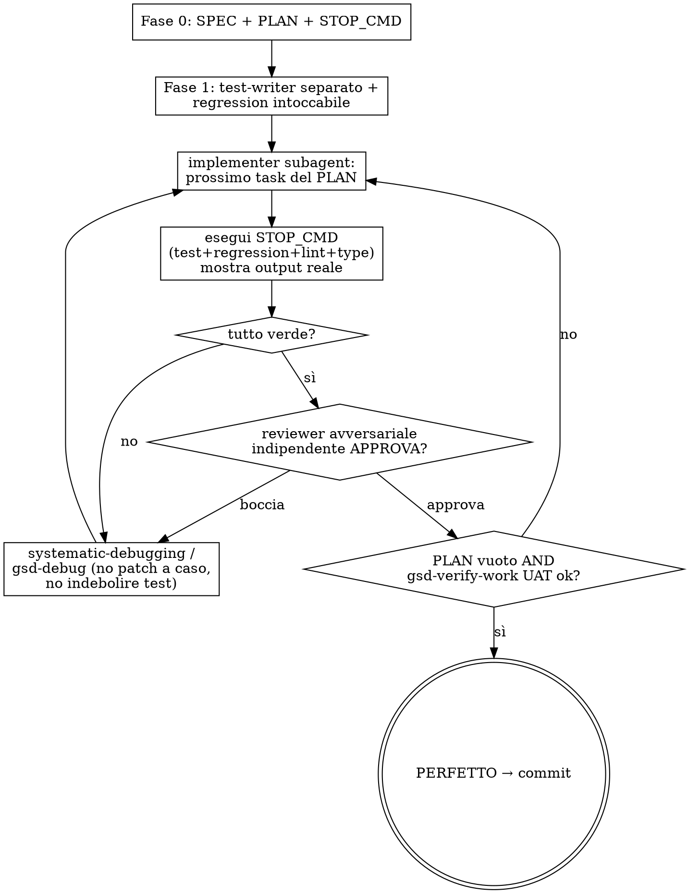

# autoloop — autonomous loop “define → implement → test → fix until perfect”

Index: When to use it · Principle · Requirements · Phase 0 · Phase 1 · Phase 2 · Phase 3 · Stopping criteria · Flowchart · Rules · Extensions · Self-improvement

Orchestrate existing skills (GSD, superpowers, ralph-loop, when installed) in a single self-contained loop with a **gate for
genuine tests**: the loop stops only when the work is truly finished, not merely when "tests are green".
It doesn't duplicate those skills: it coordinates them.

Copy and tick (if a check fails, go back where indicated):
- [ ] Phase 0 closed: SPEC, PLAN and measurable stop criteria (if they are not measurable, stay at step 4)
- [ ] Phase 1 closed: tests written by the test-writer, regression frozen, STOP_CMD written (if one is missing, go back to step 5)
- [ ] Each iteration of step 11 shows the real output and goes to the reviewer (if it is red, debug and step 11 again)
- [ ] Step 3: validate, verify, audit, doc (if a check fails, go back to step 11)
- [ ] Step 15: all green and UAT confirms the intent

## When to use it / when not to

| Situation | Right skill |
|---|---|
| “Complete THIS task/feature on your own, until it's perfect” | **autoloop** (this) |
| "Work while I sleep / research + report + nightly build" | `lavoro-notturno` (can call autoloop) |
| Medium task, one turn R→P→I→T | `rpit-loop` |
| Raw loop driver (relaunches same prompt) | `ralph-loop` (autoloop uses it as a motor) |

## Principle

The agent must never be able to "win" by weakening the tests: if it could, the loop would end green without having solved anything. The value ("when I reopen I have nothing to fix") comes from the gates, not from the loop. Gate detail: `references/test-gates.md`.
## Requirements

For examples of STOP_CMD (suitable for real project commands):
- Python: `.venv/bin/pip install pytest ruff mypy` (Linux) · `.venv/Scripts/pip install pytest ruff mypy` (Windows)
- Frontend: `npm --prefix frontend install` · E2E: `npm i -D @playwright/test && npx playwright install`
- superpowers must be installed and active where you write code; ralph-loop is optional: if missing, the driver is the integrated `/loop`. GSD only in projects with `.planning/` (skill `indice-gsd`); without GSD, the steps that name it are done manually with `rpit-loop` and `testing`.

---

## PHASE 0 — Definition (long, one time)

Don't skip it: the quality of the loop is limited by the quality of the spec and stop criteria.

1. **New project** → `gsd-new-project`. **Feature on existing project** → `gsd-spec-phase`.
2. `gsd-discuss-phase` → close ambiguities with adaptive questions BEFORE writing code.
3. `gsd-plan-phase` → executable plan with atomic tasks and goal-backward verification.
4. Write the **measurable stopping criteria** (see below). If they are not measurable, do not proceed.

Output Phase 0: `SPEC.md` + `PLAN.md` + stop criteria. (Ideas for richer specs: GitHub Spec Kit, BMAD.)

## PHASE 1 — Truth kit (anti-reward hacking)

5. **Separate test writer from implementer.** Derive tests from SPEC/UAT with a dedicated subagent
(`gsd-add-tests`), **not** from the code. The implementer will NOT be able to modify them.
6. **Regression-suite untouchable.** Freeze the existing suite (fail-to-pass + pass-to-pass): the agent must
pass the new tests AND don't break the old ones. Mark these files as read-only for the loop.
7. **Define STOP_CMD** = ALL true:
`new tests pass` ∧ `regression intact` ∧ `lint/type clean` ∧ `reviewer approves` ∧ `gsd-verify-work UAT ok`.

## PHASE 2 — Autonomous loop (the core)

8. **Subagent-driven execution** (plans always execute like this): fresh subagent for each task + review.
Use `subagent-driven-development`. Using more than 5 subagents in total first requires a token estimate and the user's approval.
9. **Loop Driver**: `ralph-loop` or the built-in `/loop`. For night runs, invoke it from `lavoro-notturno`
(no questions: decide and write down).
10. **Multi-tier mode** (optional, for backlog with priority P1/P2/…): tier N+1 starts ONLY after
that `STOP_CMD(tier N)` is entirely green AND the human checkpoint is passed. Persistent tier status
between iterations. Red dependencies block the tier. Detail: `references/gates-extended.md §1`.
11. **At each iteration** execute the loop (see flowchart):
- implementer subagent executes the next task of the PLAN;
- run `nuovi test` + `regression` + `lint/type` and **show real output**
(`verification-before-completion` — never state "fact" without evidence);
- **independent adversarial critic** (fresh subagent): agent `revisione-codice` (or
`gsd-code-review`, if GSD is installed). Must try to BREAK the job;
- if something is red or the reviewer fails → `systematic-debugging` / `gsd-debug` (persistent state between
cycles), then **go back to step 11** (implementer). Never randomly patch or weaken a test to pass.

## PHASE 3 — Final verification (before “done”)

12. `gsd-validate-phase` (Nyquist) + `gsd-verify-work` (UAT) + `gsd-integration-checker` (E2E).
13. `gsd-audit-uat` / `gsd-audit-milestone`: Does the delivered match the original intent?
14. **Always-document gate**: use the `docs` agent (or the project's documentation skill) to update relevant docstrings and
`.claude/docs/`. The tier is not "done" without updated documentation (§4 gates-extended).
15. Only then is the work "perfect". Commit and push as per skill `git-workflow`, with `Closes #N` if there is an issue.

**If any of steps 12–14 fail, return to step 11** (implementer) with the defect found, then repeat Phase 3.
Finish only when steps 12-14 all pass and the STOP_CMD is entirely green.

---

## Stopping criteria — must be measurable

Wire STOP_CMD on real commands, not judgments. This is an example to adapt to the project commands (FastAPI + React; on Windows `.venv/Scripts/...` instead of `.venv/bin/...`):

```bash
# Everything must exit with code 0
.venv/bin/python -m pytest tests/ -q              # new tests + regression
.venv/bin/ruff check .                            # lint
.venv/bin/python -m mypy app/                     # type check (if applicable)
npm --prefix frontend run lint                    # lint frontend
npm --prefix frontend test -- --run               # test frontend
npx playwright test                               # E2E by role (§2 + §3 gates-extended)
# + reviewer subagent: APPROVED
# + role-based gate: positive + negative RBAC tests pass (§3)
# + UX-simplicity gate: no native controls, ≤ 3 clicks, onboarding present (§5)
# + gsd-verify-work: UAT PASS
```

The loop continues until ANY command fails or the reviewer fails. It only stops when **everyone** passes.

## Loop flowchart



## Rules (summary)

- Never modify or weaken tests or regression-suites to pass the loop: green is no longer worth anything. This rule today is only written (hook candidate).
- Never declare "done" without real verification output (`verification-before-completion`).
- Tests written by a subagent separate from the implementer, anchored to SPEC/UAT.
- Each iteration goes through an independent adversarial reviewer.
- Stop only if STOP_CMD is entirely green and the UAT confirms the intent.
- Subagent-driven execution (fresh subagent plus reviews).

## Extensions (advanced gates)

Five operational and measurable gates documented in `references/gates-extended.md`:
§1 **multi-tier** (tier N+1 only after green STOP_CMD + checkpoint) · §2 **Playwright E2E** (flow for each
user process) · §3 **role-based** (E2E per role + negative RBAC tests) · §4 **doc-always** (doc
updated at the end of tier) · §5 **UX-simplicity** (≤ 3 clicks, onboarding, no controls
browser native).

## Notes

- Skill **generic**, not linked to a project.
- If you want a multi-model performer outside Claude Code: same discipline with **OpenHands** or **Aider**
(`--test-cmd` on your regression suite).

## Self-improvement (Karpathy philosophy)

Same principle as `github.com/karpathy/autoresearch`: **an immutable judge** that the agent cannot touch
+ **only one editable artifact** + **keep/revert only if the metric improves**. To strengthen a skill with
this pattern, generate the judge (eval train/val) with `evals-from-spec` and use it as the loop's STOP_CMD.

## Instance specifics

Run `python <this skill's base directory>/../../scripts/skill-overlay.py autoloop` and apply what it prints (it may print nothing).
